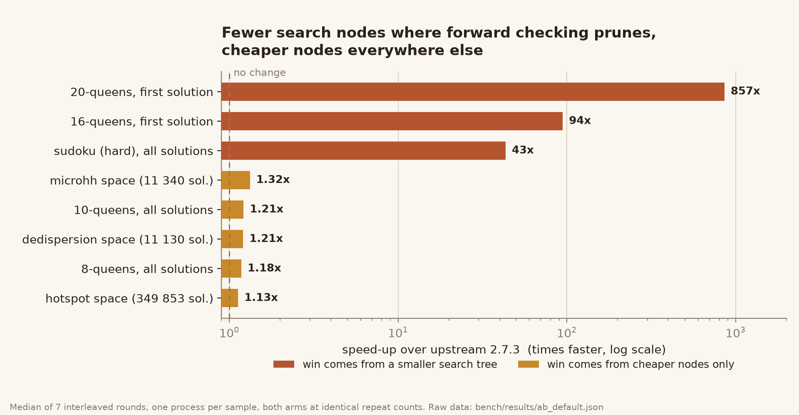
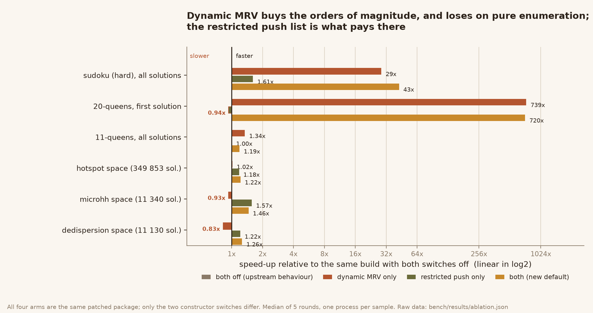

# Benchmarks

All numbers in this file were produced on the machine described below, by the
scripts in `bench/`, from the raw JSON files in `bench/results/`. Nothing here
is estimated from complexity analysis; where a case could not be measured it is
marked as such.

---

## 1. Environment

| | |
|---|---|
| CPU | Windows 11 (win32), desktop PC |
| OS | Windows, `win32` |
| Python | 3.13.14 (`C:\Users\15082\.workbuddy\binaries\python\envs\default`) |
| Package | pure Python (no Cython build), `constraint` imported from the checkout |
| Baseline (`A`) | upstream `python-constraint` @ `d91ba03` (v2.7.3), unmodified |
| Optimized (`B`) | this delivery |
| Solver | `OptimizedBacktrackingSolver` (the default), unless stated otherwise |

**Why the method matters here.** A single n-queens-8 solve takes ~11 ms. Two
runs of *byte-identical* code on this machine were measured up to 2-3x apart
when other work was running, so "run A, run B, divide" produces noise, not data.
Every number below therefore comes from `bench/ab_bench.py`, which:

1. runs each sample in its own process (no cross-case profile pollution),
2. alternates the two arms every round and rotates the order (A/B, then B/A),
3. uses a **single repeat count for both arms**, calibrated once from the
   baseline warm-up, so both arms do exactly the same amount of work,
4. reports the **median of the per-round ratios** (not a ratio of medians),
   together with the min/max spread and the number of rounds B won.

A result where the spread is wide and the win count is near 50% is a non-result
and is reported as such.

---

## 2. Reproduce

```bash
# from the project root; B is this directory, A is any upstream checkout
python bench/ab_bench.py --a /path/to/upstream --b . --rounds 7 \
                         --out bench/results/ab_default.json

# other solvers
python bench/ab_bench.py --a /path/to/upstream --b . --rounds 5 \
                         --solver BacktrackingSolver \
                         --cases queens-10-all,sudoku-hard-all,dedispersion-all

# ablation (same package, the two switches flipped)
python bench/ablation.py --pkg . --rounds 5 --out bench/results/ablation.json

# deterministic metrics: constraint invocations, no timing at all
python bench/run_bench.py --pkg . --reps 1 --solvers OptimizedBacktrackingSolver
```

The benchmark cases are defined in `bench/run_bench.py:build_cases()`; each one
declares its expected solution count and the run aborts if a count changes, so
the timing comparison can never silently compare different searches.

Case list:

| case | what it is |
|---|---|
| `queens-8/9/10/11-all` | n-queens as a binary CSP, enumerate every solution |
| `queens-16/20-first` | n-queens, stop at the first solution (deep search, little pruning help) |
| `sudoku-hard-all` | classic "hard" 9×9 grid, 27 `AllDifferentConstraint`s + 30 givens, unique solution |
| `dedispersion-all` | the official upstream benchmark, 11 130 solutions |
| `microhh-small-all` | the official `microhh` search space, downscaled to 11 340 solutions (the full 138 600-solution version is too slow to repeat 20x) |
| `hotspot-all` | the official upstream benchmark, 349 853 solutions — the enumeration-heavy stress case |

---

## 3. Results — default solver, 7 rounds



`ratio = A / B`; > 1 means this build is faster. Raw data:
`bench/results/ab_default.json`.

| case | A (upstream) | B (this build) | ratio (median) | range over 7 rounds | B faster in |
|---|---:|---:|---:|---|---:|
| `queens-8-all` | 13.04 ms | 11.44 ms | **1.18x** | 1.00–1.20x | 6/7 |
| `queens-10-all` | 235.58 ms | 196.34 ms | **1.21x** | 1.15–1.31x | 7/7 |
| `queens-16-first` | 103.01 ms | 1.10 ms | **94x** | 77–114x | 7/7 |
| `queens-20-first` | 2 627.68 ms | 3.12 ms | **857x** | 534–1 606x | 7/7 |
| `sudoku-hard-all` | 9 825.63 ms | 228.77 ms | **43x** | 41–83x | 7/7 |
| `dedispersion-all` | 39.21 ms | 32.84 ms | **1.21x** | 1.17–1.33x | 7/7 |
| `microhh-small-all` | 84.46 ms | 62.93 ms | **1.32x** | 1.29–1.40x | 7/7 |
| `hotspot-all` | 1 490.74 ms | 1 332.97 ms | **1.13x** | 1.04–1.73x | 7/7 |

Reading these honestly:

* The **two-order-of-magnitude** numbers come from **search-tree reduction**, not
  from micro-optimisation. On 20-queens the upstream search burns 4 902 182
  constraint invocations; this build needs 6 649 (deterministic counts, see §5).
  The heuristic finally sees that forward checking has reduced some other
  variable to a single value, and takes it.
* The **1.1–1.3x** numbers (`queens-8`, `dedispersion`, `microhh`, `hotspot`) are
  the honest per-node cost of the old loop: on problems where the search tree is
  already tight, all that is left to win is the rebuilt/sorted heuristic list and
  the O(V) push/pop, and that is worth 10–30%.
* `queens-8-all` won only 6/7 rounds with a range touching 1.00x — at 11 ms the
  case is at the edge of what this machine can resolve reliably, and it is
  reported that way rather than rounded up.

---

## 4. Results — the other two backtracking solvers

`BacktrackingSolver` (5 rounds, `bench/results/ab_backtracking.json`):

| case | A | B | ratio (median) | range | B faster in |
|---|---:|---:|---:|---|---:|
| `queens-10-all` | 237.87 ms | 206.60 ms | 1.08x | 0.93–1.20x | 4/5 |
| `sudoku-hard-all` | 563.85 ms | 238.86 ms | **2.26x** | 2.12–2.51x | 5/5 |
| `dedispersion-all` | 99.41 ms | 34.72 ms | **2.77x** | 1.66–3.18x | 5/5 |

`RecursiveBacktrackingSolver` (5 rounds, `bench/results/ab_recursive.json`):

| case | A | B | ratio (median) | range | B faster in |
|---|---:|---:|---:|---|---:|
| `queens-9-all` | 56.37 ms | 47.18 ms | 1.19x | 1.06–1.29x | 5/5 |
| `dedispersion-all` | 87.17 ms | 32.37 ms | **2.73x** | 2.57–3.07x | 5/5 |

`BacktrackingSolver` keeps the *static* variable order on purpose (it is the
reference solver), so its gain is purely "stop rebuilding the sort at every node
and stop pushing every domain". `queens-10-all` at 1.08x with one round below
1.0 is a weak result and is not counted as a win.

---

## 5. Deterministic metrics (no timing involved)

Constraint invocations, counted by wrapping every `Constraint.__call__`
(`bench/results/deterministic_upstream.txt` and `deterministic_opt.txt`). These
numbers are exact and machine-independent.

| case | solutions | invocations (upstream) | invocations (this build) | reduction |
|---|---:|---:|---:|---:|
| `queens-8-all` | 92 | 24 582 | 21 360 | 1.15x |
| `queens-9-all` | 352 | 109 080 | 92 040 | 1.19x |
| `queens-10-all` | 724 | 480 304 | 377 782 | 1.27x |
| `queens-11-all` | 2 680 | 2 364 060 | 1 769 226 | 1.34x |
| `queens-16-first` | 1 | 212 303 | 2 057 | **103x** |
| `queens-20-first` | 1 | 4 902 182 | 6 649 | **737x** |
| `sudoku-hard-all` | 1 | 1 916 096 | 54 594 | **35x** |
| `dedispersion-all` | 11 130 | 17 714 | 17 714 | 1.00x |
| `microhh-small-all` | 11 340 | 25 125 | 24 460 | 1.03x |
| `hotspot-all` | 349 853 | 914 440 | 853 581 | 1.07x |

This table is the one to quote when someone asks "did the algorithm get better or
did the code just get faster": `queens-20-first` does **737x less search work**,
and `dedispersion` does exactly the same amount of search work (it is a pure
enumeration where the tree is already tight) and only gets faster from the
removed per-node overhead.

---

## 6. Ablation — which change is responsible



All four arms are the **same patched package**, only the two constructor
switches differ (`bench/ablation.py`, `bench/results/ablation.json`, 5 rounds,
speed-up is relative to the `legacy` arm = `dynamic_mrv=False,
restricted_pushdomains=False`, i.e. upstream behaviour).

| case | legacy | dynamic MRV only | restricted push only | both (new default) |
|---|---:|---:|---:|---:|
| `queens-11-all` | 1 343.65 ms | 1 047.58 ms (**1.34x**) | 1 478.75 ms (1.00x) | 1 173.48 ms (**1.19x**) |
| `sudoku-hard-all` | 9 676.64 ms | 366.28 ms (**28.7x**) | 6 023.70 ms (**1.61x**) | 234.44 ms (**42.7x**) |
| `dedispersion-all` | 43.59 ms | 52.78 ms (**0.83x**) | 35.72 ms (**1.22x**) | 34.63 ms (**1.26x**) |
| `microhh-small-all` | 91.34 ms | 99.61 ms (**0.93x**) | 57.10 ms (**1.57x**) | 63.27 ms (**1.46x**) |
| `hotspot-all` | 1 584.86 ms | 1 531.05 ms (1.02x) | 1 346.61 ms (**1.18x**) | 1 285.78 ms (**1.22x**) |
| `queens-20-first` | 2 434.10 ms | 3.24 ms (**739x**) | 2 559.10 ms (0.94x) | 3.32 ms (**720x**) |

What the ablation says, including the uncomfortable parts:

* **Dynamic MRV is what buys the orders of magnitude**, and it only does so when
  forward checking actually prunes (`queens-16/20`, `sudoku`).
* **On pure enumeration it is a small net loss** (`dedispersion` 0.83x,
  `microhh` 0.93x): the search tree is already tight, so re-evaluating the
  heuristic at every node only costs time. That is why the restricted-push
  change exists — it is the one that pays on those cases (1.22x, 1.57x) — and why
  the two together still land at 1.26x / 1.46x rather than 1.0x.
* **On `queens-11-all` the two changes interact**: MRV alone is 1.34x, but
  both together is 1.19x, i.e. the narrower push/pop costs something when the
  variable order keeps changing. Both are still ahead of `legacy`, and
  `sudoku`/`queens-20` gain far more than `queens-11` loses, but this is the
  reason the two switches are exposed separately instead of being hard-wired.
* An earlier attempt at a "fail-first only when a domain is down to 0/1" hybrid
  was measured at **1.9 s vs 0.85 s** on `queens-11-all` (i.e. clearly worse than
  plain dynamic MRV) and was removed rather than shipped behind a flag.

---

## 7. Memory

Not benchmarked. The change removes allocations (a per-node list of V tuples and
a sort) and adds one `SearchPlan` per solve plus a `taken` bitmap of V booleans,
so peak memory should be flat or slightly lower, but no measurement of resident
memory was taken on this machine and none is claimed here.

---

## 8. Things that were not measured / do not apply

* **Cython build.** Upstream also ships Cython-generated `constraint/*.c`. They
  were removed from this archive (generated artifacts, and they no longer match
  the modified `solvers.py`). Compiling them is out of scope; the same edits
  would have to be regenerated with `cythonize_build.py`. Expect the *relative*
  gain to shrink there, because the Python-level overhead this patch removes is
  exactly what Cython already removes.
* **`ParallelSolver`** — untouched. Upstream documents it as experimental and
  "unlikely to be faster than OptimizedBacktrackingSolver".
* **`MinConflictsSolver`** — untouched; it is local search with no forward
  checking, so none of these changes apply to it.
* **Full-size `microhh`** (138 600 solutions) — measured once at ~0.5 s upstream
  during exploration, but not included in the repeated runs (20x repetition would
  have taken tens of minutes per arm). The downscaled variant is used instead.
* **Multi-core / memory-bandwidth effects** — not investigated.

---

## 9. Correctness gates run before any of the above

Every benchmark case asserts its solution count, and the following were run
before the timings were recorded:

```
python -m pytest tests -q
# 76 passed, 1 skipped, 2 failed
#   the 2 failures also fail on the unmodified upstream checkout in this
#   environment: test_if_compiled (expects a Cython build) and
#   test_versioning (needs poetry)

python -m pytest tests/test_solver_optimizations.py -q
# 29 passed
```

The new test file includes solution-set equality against
`OptimizedBacktrackingSolver(dynamic_mrv=False, restricted_pushdomains=False)`
on n-queens, sudoku, `dedispersion`, sparse graphs, unary constraints,
non-string variable keys, unsatisfiable problems and repeated solves.
